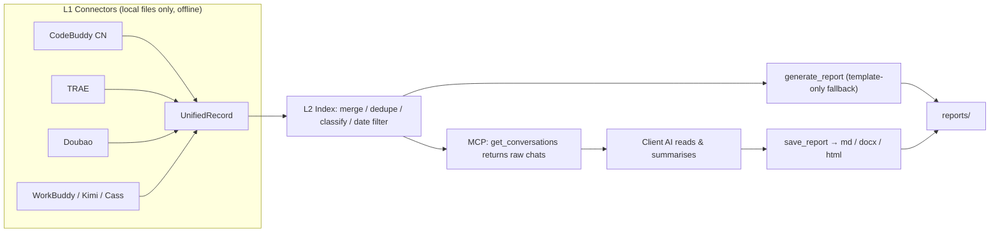

# Aiscribe · Local-first AI Session Report Aggregator

**Local-first, privacy-first.** Collects your AI coding/chat tool sessions from your own machine,
groups them by project, and turns them into daily/weekly reports (Markdown / Word) —
exposed to any AI client as an **MCP server**.

> The MCP tools fetch *every real message you sent today*; your AI assistant reads them and writes the report.
> That division of labour is why the output is far better than template-only reporting.

English | [简体中文](README.zh-CN.md)

---

## Why

Your day is scattered across several AI tools: code edits in an IDE, debugging in a chat window,
design notes in another tool. When report time comes you reconstruct it from memory — mixed-up projects,
wrong dates, vague summaries.

Aiscribe does it differently:

1. **Read locally** — pull what you actually sent today from each tool's local database/logs, filtered by a
   single timezone (Asia/Shanghai). Nothing leaves your machine.
2. **Let the AI summarise** — hand the raw conversations to your AI assistant over MCP; it merges duplicates,
   distils *topics* (not messages), and groups them by project.
3. **Format and save** — emit a fixed `1、Project` / `①、Topic` layout with a **detailed version + a short version**,
   written to local `reports/` as md, docx, or a self-contained shareable html page.

## Features

- **6 built-in connectors** — CodeBuddy CN, TRAE, Doubao, WorkBuddy, Kimi, Cass; easy to extend
- **Understands, doesn't template** — `get_conversations` returns per-project raw user inputs; the client AI writes the report
- **Correct date filtering** — only sessions starting that day, or spanning the night (≤ 1 day); a week-old session touched once won't leak into today
- **Automatic project grouping** — keyword rules (`projects.json`) → title hints → **cwd's last path segment** fallback; new projects need zero config
- **Daily / weekly / custom range**, rendered in Asia/Shanghai time
- **Markdown, Word, or shareable HTML** — `--format docx` writes hand-rolled WordprocessingML, `--format html`
  writes a single self-contained page (inline CSS, no JS, no external assets); both pure stdlib
- **Optional LLM polish** (`--llm`, DeepSeek-compatible): the model may only rewrite each item's text —
  the report skeleton (report title, project sections, item order) is machine-built and every reply must pass
  a structure/format check, otherwise it falls back to the template silently
- **Zero third-party dependencies (core)** — data access, report building, and MCP run on the Python standard
  library alone, no `pip install` needed. The one exception is the **guide page frontend**: `ui.py`'s server is
  still stdlib, but the page pulls Tailwind / React / Framer Motion from a public CDN, so the first load needs
  internet. Offline it shows an explicit notice instead of a blank page and points you at the CLI or MCP.
  Your data never leaves the machine either way.
- **Any MCP client** — stdio transport; TRAE, Claude Code, Cursor, dsh all work
- **Local guide page** — `python -m ai_report ui` serves a loopback-only **six-screen wizard**: splash → ① per-source real scan → ② date / week / custom range → ③ pick sessions by project (with time trimming) → ④ template and output format → generating screen → **generate the report on the spot** (template-only, written straight into `reports/`) or copy a ready-to-paste instruction for your AI
- **Time trimming** — set a start/end per session in the guide page; segments outside the window are dropped
  by the tool itself (not by a prompt hint), so they can never leak into the report
- **Format cloning** — upload the reports you already write (md / txt / docx / image), the layout is extracted locally into a template, and every later report reproduces your format (structure only, never the sample's content)

## Quick start

```powershell
# 0) Python 3.9+, no pip install needed
git clone https://github.com/<you>/Aiscribe.git
cd Aiscribe

# 1) See which data sources were auto-discovered on this machine
python -m ai_report sources
python -m ai_report config

# 2) Template-only report first (no AI needed)
python -m ai_report daily --date 2026-10-16

# 3) Recommended: open the local guide page (scan → pick → generate, or copy an instruction)
python -m ai_report ui

# 4) Or wire the MCP server + Skill into your AI client
```

### Local guide page

```powershell
python -m ai_report ui            # port 5071, opens your browser
python -m ai_report ui --port 5080 --no-open
```

Bound to `127.0.0.1` only. Four steps: **source scan** (each source lights up only after it is really
read, tagged with its content level), **time window** (daily / the natural week of a chosen day / an
explicit custom range), **session picking** (lanes per project, all selected by default — anything you
untick never reaches the AI; each session can also be cut to a time window with ✂), **template & output**
(md / docx / html, plus format cloning from your old reports).

The generating screen offers two ways out, pick either:

- **Generate report (runs AI summarisation by default)** — render a draft locally from a template,
  filtered by your ticks and trims, then hand the **draft text** to the summarisation engine below
  and write the result into `reports/`. The page shows the file name, path and open/download links,
  and states plainly whether the body was summarised or is still the raw template draft.
  **With no engine configured it does not pretend to summarise** — it falls back and says why.
- **Copy instruction** — paste the generated instruction (carrying the record ids you selected and the
  format spec) into your AI chat; the AI reads the raw sessions and summarises, which gives **the best
  quality**. In that path the file is written by your AI client via `save_report`.

### Summarisation engine (optional)

Summarisation only happens on the *already-collapsed draft* level: the draft is locally assembled
(e.g. CodeBuddy CN's real input timeline for the day, each entry capped at 400 chars). It contains
**no AI replies and is not the full transcript**, but it does contain fragments of your own input.
Configure it via a gitignored `llm.json` or the matching environment variables:

```json
{ "provider": "deepseek", "model": "deepseek-chat", "api_key": "sk-..." }
```

- **DeepSeek** — set `DEEPSEEK_API_KEY`, or put it in `llm.json`
- **Nothing leaves the machine** — switch `"provider"` to `"ollama"` and point `"model"` at a model you
  have pulled locally (e.g. `qwen3.8:27b`); talks to `http://127.0.0.1:11434`, no key needed
- The CLI has the same switch: `python -m ai_report daily --llm` (falls back to the template on failure)

### Time trimming (cut a session down to a time window)

A long session often mixes yesterday's leftovers with today's work. Open the guide page, click the
✂ button on a session chip, and set a start/end time. Everything outside that window is dropped
**inside the tool** — `get_conversations` simply never returns it, so the AI cannot write it back in.
The preview and the material handed to the AI stay in sync, and a `已剪辑` badge marks the chip
(`清空全部剪辑` undoes everything). Times are Beijing time; an end earlier than the start means an
overnight window (e.g. `22:30 ~ 02:00`); segments without a timestamp are always kept.
Trims live in `<repo>/trims.json` (override with `AIREREPORT_TRIMS`, gitignored).

### Format cloning (reproduce the report layout you already use)

```powershell
python -m ai_report learn old-daily.md --name my-format   # learn from one sample
python -m ai_report learn a.md b.docx --name my-format    # several samples vote on the common layout
python -m ai_report templates                             # list what has been learned
python -m ai_report daily --date 2026-10-16 --template my-format
```

- **Structure only** — title line, header line, project heading, item marker, TODO block,
  footer, dual version or not. The sample's actual work content is never carried over.
- **Image samples** — no OCR (keeps the zero-dependency rule). Images are archived and the
  host AI is asked to read them and write the structure back via the `save_template` MCP tool.
- **Two consumers** — the AI path (`get_format_spec` injects the spec into the prompt; primary)
  and the CLI path (`--template` styles the template-only output).
- Templates live in `templates/*.json` (override with `AIREREPORT_TEMPLATES_DIR`, gitignored);
  set `AIREREPORT_TEMPLATE` to choose which one is active by default.

### MCP + Skill (recommended)

MCP config (point the args at your clone):

```json
{
  "mcpServers": {
    "aireport": {
      "command": "python",
      "args": ["<repo>/run_mcp_stdio.py"]
    }
  }
}
```

Skill: copy [`skills/ai-report/SKILL.md`](skills/ai-report/SKILL.md) into your client's skills directory
(TRAE: `.trae/skills/`; Claude Code: `~/.claude/skills/`).

Then just ask: *"Generate my report for today."*
The AI runs `list_sources` → `get_conversations` (overview, then per-project detail) → summarise → `save_report`.

Client-by-client setup and known pitfalls (including TRAE's space-splitting `command`) live in
[`mcp/README.md`](mcp/README.md) (Chinese).

## How it works



## Report format

One file, two versions — detailed on top, a `---` separator, short version below.

```markdown
# AI 日报 2026-10-16

**1、订单服务（重构下单链路，09:06–18:20）：**

①、接口契约梳理：确认 v2 字段清单并落成 contracts/order.md。

②、超时问题定位：定位到连接池配置过小，改为 20 后压测回归通过。

---

# AI 日报（简洁版）2026-10-16

**1、订单服务：**

①、接口契约梳理

②、超时问题定位
```

Rules (hard-coded in the Skill): projects use `**1、Name：**`, topics use `①②③`;
the short version drops the parenthetical context and keeps **only the text before the `：`**
of each detailed bullet.

## CLI

```powershell
python -m ai_report daily  [--date YYYY-MM-DD] [--llm] [--out FILE] [--format md|docx|html] [--template NAME]
python -m ai_report weekly [--date YYYY-MM-DD] [--template NAME]
python -m ai_report range  --start YYYY-MM-DD --end YYYY-MM-DD [--template NAME]
python -m ai_report sources
python -m ai_report config
python -m ai_report learn SAMPLE... [--name NAME]   # learn a layout from past reports
python -m ai_report templates                      # list learned format templates
python -m ai_report mcp --stdio          # MCP stdio (for AI clients)
python -m ai_report mcp --port 5070      # optional local HTTP, 127.0.0.1 only
python -m ai_report ui                   # local guide page, 5071, loopback only
```

Windows helpers: [`scripts/run_daily.bat`](scripts/run_daily.bat) / [`scripts/run_weekly.bat`](scripts/run_weekly.bat);
scheduling example: [`automation_example.json`](automation_example.json).

## Supported sources

| Source | Auto-discovered location | What is available locally |
|---|---|---|
| CodeBuddy CN | `%APPDATA%/CodeBuddy CN/` | Session metadata + **raw sent inputs via `onAgentStart: userInput=` in logs** |
| TRAE | `~/.trae-cn/memory/projects/` | Per-message summaries + `topics.md` session summaries (richest) |
| Doubao | `%LOCALAPPDATA%/Doubao/User Data/Default/IndexedDB` | Titles and timestamps (LevelDB / V8 blobs) |
| WorkBuddy | `~/.workbuddy/workbuddy.db` | Titles and timestamps (bodies stay in the cloud) |
| Kimi | `%APPDATA%/kimi-desktop/` | Metadata + edited file paths (used to locate the project dir) |
| Cass | `%APPDATA%/coding-agent-search/` | Sessions + first user message |

Every path is derived from `%APPDATA%` / `%LOCALAPPDATA%` / the user profile — no hard-coded usernames —
and each can be overridden by an environment variable (see `python -m ai_report config`).

## Configuration

| Env var | Purpose | Default |
|---|---|---|
| `AIREREPORT_REPORTS_DIR` | Report output directory | `<repo>/reports` |
| `AIREREPORT_TEMPLATES_DIR` | Learned format templates directory | `<repo>/templates` |
| `AIREREPORT_TEMPLATE` | Default active format template | newest learned template |
| `AIREREPORT_TRIMS` | Session time-trim file | `<repo>/trims.json` |
| `AIREREPORT_PROJECTS` | Project classification rules | `<repo>/projects.json`, then `~/.aireport/projects.json`, then built-ins + cwd fallback |
| `CODEBUDDY_CN_DB` etc. | Override a source path | Auto-discovered |
| `DEEPSEEK_API_KEY`, `LLM_PROVIDER` | Optional LLM polish | `--llm` falls back to template mode |

Copy [`projects.example.json`](projects.example.json) to `projects.json` to pin your own project names.

## Privacy

- Everything is read from local files only; connectors never go online or upload anything
- Only the **finished report text** (no raw conversations) can reach an LLM endpoint, and only when
  you explicitly pass `--llm`
- Reports stay in local `reports/`; both the optional HTTP mode and the guide page bind to `127.0.0.1` only
- `.gitignore` excludes `reports/`, `projects.json`, `trims.json`, `dingtalk_config.json`, `automation.json`

## Layout

```
ai_report/            core package (stdlib only)
  connectors/         L1: base / codebuddy_cn / trae / doubao / workbuddy / kimi / cass / registry
  index.py            L2: merge, dedupe, classify, date filter, shared window/payload helpers
  generator.py        L3: daily/weekly/range templates (can follow a learned layout)
  template.py         format cloning: extract layout from past reports, store specs for the AI
  trim.py             session time trimming: window parsing, segment clipping, trims.json store
  html.py  docx.py    exports: self-contained shareable page / Word
  llm.py              L4: optional synthesis (rewrites item text only, must pass format check)
  cli.py  mcp_server.py
  ui.py  web/         local guide page: stdlib HTTP server + six-screen wizard UI (frontend via CDN, see above)
skills/ai-report/     SKILL.md — the summarisation methodology and output spec
mcp/                  client setup guides
docs/                 data-source adapters, and the full build prompts for this project
examples/             connector_template.py
scripts/              Windows one-click scripts
tests/                unittest suite
run_mcp_stdio.py      MCP stdio launcher (stable path for client configs)
reports/              generated reports (auto-created, gitignored)
templates/            learned format templates + archived samples (auto-created, gitignored)
trims.json            guide-page time trims (auto-created, gitignored)
```

## Tests

```powershell
python -m unittest discover -s tests -t .
```

## Contributing

- **New data source** — see [`docs/数据源适配.md`](docs/数据源适配.md) (Chinese) and the template in
  [`examples/connector_template.py`](examples/connector_template.py)
- **Different report style** — edit the output spec in [`skills/ai-report/SKILL.md`](skills/ai-report/SKILL.md)
- **Rebuild from scratch** — [`docs/BUILD_PROMPTS.md`](docs/BUILD_PROMPTS.md) is the full prompt set that
  produced this project

## License

[MIT](LICENSE)
