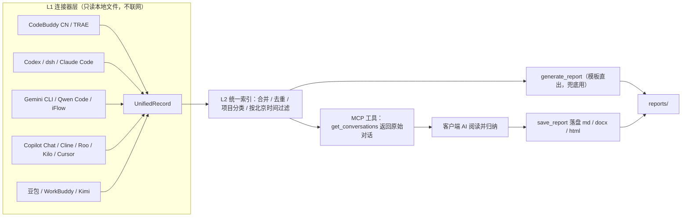

# Aiscribe · AI 会话日报聚合器

**Local-first · 隐私优先**：在本机聚合多个 AI 编码/对话工具的会话记录，
按项目分类生成日报/周报（Markdown / Word），并作为 **MCP 服务**供任意 AI 工具调用。

> 工具负责「一条不漏地取回真实对话」，你用的 AI 负责「读懂并归纳」——
> 这就是它在同一堆数据上比模板直出好得多的原因。

[English](README.md) | 简体中文

---

## 它解决什么问题

一天的工作散落在好几个 AI 工具里：在 IDE 里改代码、在助手对话框里排查、在另一个工具里画方案。
到了写日报的时候，靠回忆拼凑，结果是**项目混在一起、时间对不上、内容泛泛而谈**。

Aiscribe 的做法是：

1. **本地取数**：从每个 AI 工具留在本机的会话数据库/日志里，按**北京时间**取出你当天真实发出的内容（不联网、不上传）；
2. **交给 AI 归纳**：通过 MCP 把原始对话交给正在给你干活的 AI，由它合并同类项、提炼成事项、按项目归类；
3. **格式化落盘**：按固定的 `1、项目名：` `①、事项` 格式输出**详细版 + 简洁版**两个版本，写成本地 md / docx / 可分享 HTML。

## 特性

- **多源聚合**：内置 **16 个原生连接器** —— CodeBuddy CN、TRAE、Codex、dsh、Claude Code、Gemini CLI、Qwen Code、iFlow、Copilot Chat、Cline、Roo Code、Kilo Code、Cursor、豆包、WorkBuddy、Kimi；全部直接读本地文件，**不需要装 Cass 或者任何索引器**
- **会理解，不是套模板**：`get_conversations` 返回按项目分组的**逐条真实输入**，归纳由客户端 AI 完成
- **时间不串味**：只收“当天开始”或“跨夜不超过 1 天”的会话，一周前只被碰过一次的旧会话不会混进今天
- **项目自动归类**：关键词规则（`projects.json`）→ 标题关键词 → **cwd 路径末段目录名兜底**，新项目不用改配置
- **三种报告**：日报 / 周报 / 自定义区间，北京时间渲染
- **三种输出**：Markdown（默认，便于二次编辑）、Word（`--format docx`，纯标准库手写 WordprocessingML）、
  可分享 HTML（`--format html`，自包含单文件：样式内嵌、无脚本、无外部资源，双击即可打开）
- **可选 LLM 归纳**：`--llm` 走 DeepSeek（OpenAI 兼容端点）。模型**只能改写每个条目的文字**，
 报告骨架（报告标题、项目分节、条目顺序）由本机程序生成，返回结果还要过结构与格式校验，
  不过就退回纯模板，绝不中断
- **零三方依赖（内核）**：取数 / 报告生成 / MCP 只跑 Python 标准库，不需要 `pip install` 任何东西。
  例外只有**本地引导页的前端**：`ui.py` 的服务端仍是标准库，但页面的界面库（Tailwind / React / Framer Motion）走公网 CDN，
  **首次打开需要联网**；断网时页面不会白屏，会显示一句明确的提示并告诉你改用 CLI 或 MCP。
  会话数据本身只在读取、筛选、排版时留在本机；只有你手动勾选 AI 归纳或让云端模型读取全文时，相应文本才会进入模型上下文。
- **跨客户端**：MCP 用 stdio transport，TRAE / Claude Code / Cursor / dsh 都能接；DSH 用户可直接从插件市场安装 `dsh-aireport`（包内自带 Windows sidecar，无需装 Python）
- **装进 DSH 即用**：插件自带运行时与 MCP 桥接，安装后 agent 直接获得 7 个工具；源码运行与独立 MCP 配置仍然保留
- **本地引导页**：`python -m ai_report ui` 打开一个只监听回环地址的**六屏向导** —— 启动屏 → ① 逐源真实扫描点亮 → ② 日期 / 周报 / 自定义区间 → ③ 按项目勾选素材（含时间剪辑）→ ④ 模板与输出格式 → 生成等待页 → **一键生成报告**（本机纯模板，直接写进 `reports/`）或复制「交给 AI 的指令」
- **时间剪辑**：在引导页给单条素材设起止时间，窗口外的对话片段**由工具直接丢弃**（不是靠提示词提醒 AI），因而不可能混进报告
- **格式克隆**：上传你以前一直用的日报（md / txt / docx / 图片）→ 本机抽出排版结构存成模板 → 之后每份报告都复现你原来的格式（只学排版，不搬内容）

## 快速开始

```powershell
# 0) 需要 Python 3.9+（无需任何三方包）
git clone https://github.com/5yeah/Aiscribe.git
cd Aiscribe

# 1) 看本机发现了哪些数据源（自动发现路径，不用改代码）
python -m ai_report sources
python -m ai_report config

# 2) 先用模板直出版看看效果
python -m ai_report daily --date 2026-10-16

# 3a) 推荐：打开本地引导页（逐源扫描 → 勾选素材 → 一键出报告 / 复制指令）
python -m ai_report ui

# 3b) 或把 MCP 接进你的 AI 工具，让它按 Skill 生成（见下）
```

#### 装进 DSH（插件市场，免 Python）

在 DSH 0.2.x 的插件市场搜索 **Aiscribe**（包名 `dsh-aireport`）并安装，然后**新开会话**；
也可以用命令行：

```bash
dsh plugin --profile web add dsh-aireport
```

当前 `0.1.0` 只随包提供 **Windows x64** 运行时，其他平台会以独立平台包发布。
插件不依赖系统 Python；报告与配置写到 `~/.aireport/`。详见
[`dsh-plugin/README.md`](dsh-plugin/README.md)。

### 本地引导页（最直观的用法）

```powershell
python -m ai_report ui            # 默认 5071 端口，自动打开浏览器
python -m ai_report ui --port 5080 --no-open
```

页面只监听 `127.0.0.1`，四步走：

1. **数据源雷达** — 只列本机**真实检测到**的工具，逐个扫描、读完才亮，并标注每个源的内容等级（逐条原文 / 仅标题 / 元数据）；扫描完成后按**读到的会话数从多到少排序**，没装的工具折叠在「N 个工具未检测到」里，点一下才展开
2. **时间窗** — 日报（选一天）/ 周报（选一天取自然周）/ 自定义时间（显式起止日期）
3. **素材勾选** — 按项目泳道排列当天会话，默认全选；**取消勾选的内容不会进素材，AI 就不会写进报告**；一条会话还能用 ✂ 裁到指定时间段
4. **模板与输出** — 选 md / docx / html；**「格式克隆」**里上传你以前的日报（md / txt / docx / 图片），本机解析出排版结构存成模板，右侧骨架立刻变成你的格式

等待页有两条产出路径，任选：

- **生成报告（默认本机纯模板）** — 先在本机按你的勾选与剪辑过滤素材、用模板渲染，直接写进 `reports/`；
  页面给出文件名、路径与打开/下载链接。只有你**手动勾选「AI 归纳」**且配置了归纳引擎时，
  才会把**草稿文本**（当日摘要，有 AI 正文时附最多 120 字的结论片段，不是完整对话）交给模型改写；
  页面会明确标注「正文已由 xxx 归纳」还是「未归纳，仍是草稿」。
  **未配置归纳引擎时不会假装归纳**，而是如实退回草稿并说明原因
- **复制指令** — 把带 `ids` 与格式规范的指令贴进你的 AI 对话，由 AI 读原文归纳，**质量最高**；
  这种情况下的落盘由你的 AI 客户端调用 `save_report` 完成

### 浏览历史会话（另一个页面）

引导页只展示「你选的那一天」的素材。想翻**全部历史会话**，点右上角的
**「浏览历史会话」**，或直接打开 `http://127.0.0.1:5071/browse`：

- 左栏按**数据源**（含各自真实条数）和**项目**筛选，日期区间可任选
- 顶部搜索框同时搜**标题、摘要和逐条正文**（按 `/` 聚焦，`Esc` 关详情）
- 点任意一条，右侧抽屉展示该会话的**逐条正文 + 时间 + 项目路径**；
  只有标题/元数据的源（如 WorkBuddy、豆包）会明确标注「无正文」，不会让你误以为丢了数据
- 支持深链接：`/browse?id=dsh|session-xxxx` 直接打开某条会话
- 列表读取有 30 秒缓存（翻页、搜索不用反复扫硬盘），点「刷新」强制重读

### 归纳引擎（可选，不配也能用）

归纳只发生在「已汇总草稿」这一层：草稿是本机拼接的摘要（例如 CodeBuddy CN 的当日真实输入时间线，
每条上限 400 字），有 assistant 正文时还会附上最多 120 字的结论片段。
它**不是完整对话**，但其中确实含有你原始输入的片段——开启归纳前请确认可以接受这一点。
`llm.json`（已 gitignore）或同名环境变量都可配置：

```json
{ "provider": "deepseek", "model": "deepseek-chat", "api_key": "sk-..." }
```

- **DeepSeek**：设 `DEEPSEEK_API_KEY`，或写进 `llm.json` 的 `api_key`
- **完全不出本机**：改 `"provider": "ollama"` 并用 `"model"` 指定本机已拉取的模型（如 `qwen3.8:27b`），
  走 `http://127.0.0.1:11434`，无需 key
- 命令行侧同样可用：`python -m ai_report daily --llm`（失败自动退回模板）

### 时间剪辑（把一条会话裁到指定时间段）

一条长会话常常把昨天没干完的事和今天的活混在一起。在引导页点素材右侧的 **✂**，
设「从 / 到」两个时间点：窗口外的对话片段**由工具自己丢掉** —— `get_conversations` 根本不会返回它，
AI 也就没机会再写回报告。预览骨架与交给 AI 的素材同步生效，chip 上会打「已剪辑」标记，
右上角的「清空全部剪辑」可一键撤销。时间为北京时间；「到」早于「从」按跨夜处理（如 `22:30 ~ 02:00`）；
没有时间戳的片段一律保留。剪辑存在数据目录的 `trims.json`（源码运行时是仓库根，安装态是
`~/.aireport`；可用 `AIREREPORT_TRIMS` 覆盖，已 gitignore）。

### 格式克隆（复现你原来的日报格式）

```powershell
python -m ai_report learn 旧日报.md --name 我的日报        # 学一份（可传多份，越多越准）
python -m ai_report learn a.md b.docx --name 我的日报       # 多份样例投票，取共性
python -m ai_report templates                            # 看看学到了哪些模板
python -m ai_report daily --date 2026-10-16 --template 我的日报
```

- **只抽结构**：标题行 / 头部信息行 / 项目行 / 事项行 / 待办段 / 收尾注 / 是否双版本，**不留样例里的具体工作内容**
- **图片样例**：本机不做识图（保持零依赖），只存档并给出提示，让 AI 读图后用 MCP `save_template` 回填结构
- **两种消费方式**：AI 路径（`get_format_spec` 把规范塞进提示词，主力）/ CLI 路径（`--template` 直接排版）
- 模板存在 `<数据目录>/templates/*.json`（可用 `AIREREPORT_TEMPLATES_DIR` 覆盖），已 gitignore；设置 `AIREREPORT_TEMPLATE` 可指定默认生效的那一份

### 接入 MCP + Skill（推荐用法）

**MCP**（取数能力）——在你的 AI 工具里加一段配置，路径换成你的仓库位置：

```json
{
  "mcpServers": {
    "aireport": {
      "command": "python",
      "args": ["<仓库>/run_mcp_stdio.py"]
    }
  }
}
```

**Skill**（方法论）——把 [`skills/ai-report/SKILL.md`](skills/ai-report/SKILL.md) 放进客户端的 skills 目录
（TRAE：`.trae/skills/` 或用户级 skills 目录；Claude Code：`~/.claude/skills/`）。

之后直接对 AI 说：

> 生成我今天的日报

AI 会自动走完 **`list_sources` → `get_conversations`（摸底 + 逐项目精读）→ 归纳 → `save_report` 落盘** 全流程。

各客户端的完整配置与已知坑（含 TRAE 的 `command` 空格问题）见 [`mcp/README.md`](mcp/README.md)。

## 工作原理



| 层 | 职责 |
|---|---|
| L1 连接器 | 把每个工具的原始数据归一化为 `UnifiedRecord`；能拿到逐条原文的塞进 `raw["messages"]` |
| L2 索引 | 合并去重、项目分类、**按北京时间的“当日 + 跨夜 ≤ 1 天”规则过滤** |
| L3 生成 | 模板渲染（`generate_report`）—— 不含理解，只罗列，用于快速查看与兜底 |
| 归纳 | 由客户端 AI 通过 `get_conversations` 拿到素材后完成（**这套方案的关键**） |
| L4 可选 | LLM 润色（`--llm`）、Word / 可分享 HTML 导出 |

## 报告格式

一份文件里放两个版本：上半详细版，`---` 分隔，下半简洁版。

```markdown
# AI 日报 2026-10-16

**汇报人：** 张三 ｜ **部门：** 算法组 ｜ **日期：** 2026年10月16日

> 数据来源：CodeBuddy CN 当日真实发送消息（127 条逐条输入）、TRAE 本地记忆、豆包（本地聚合，隐私优先）

**1、订单服务（重构下单链路，09:06–18:20）：**

①、接口契约梳理：确认 v2 字段清单并落成 contracts/order.md。

②、超时问题定位：定位到连接池配置过小，改为 20 后压测回归通过。

**2、数据看板：**

①、新增日活趋势图，支持按渠道筛选。

**3、待办事项：**

①、订单服务：连接池压测报告归档。

---

# AI 日报（简洁版）2026-10-16

**1、订单服务：**

①、接口契约梳理

②、超时问题定位

**2、数据看板：**

①、新增日活趋势图
```

格式约定（在 Skill 里固化为硬规则）：

- 项目用 `**1、项目名：**`，事项用 `①②③…`；
- 详细版项目名后可跟“（上下文，起止时间）”，**简洁版一律去掉括号**；
- 简洁版每条**只保留详细版 `①` 冒号之前的事项名**，冒号后的说明全部删掉。

## 命令行

```powershell
python -m ai_report daily  [--date YYYY-MM-DD] [--llm] [--out 文件] [--format md|docx|html] [--template 模板名]
python -m ai_report weekly [--date YYYY-MM-DD] [--template 模板名]
python -m ai_report range  --start YYYY-MM-DD --end YYYY-MM-DD [--template 模板名]
python -m ai_report sources     # 列出本机数据源与可用状态
python -m ai_report config      # 显示配置（敏感字段打码）
python -m ai_report learn 样例... [--name 模板名]  # 从旧日报学排版，固化成模板
python -m ai_report templates   # 列出已学到的格式模板
python -m ai_report mcp --stdio # MCP stdio 模式（客户端接入用）
python -m ai_report mcp --port 5070   # 本地 HTTP（仅监听 127.0.0.1，可选）
python -m ai_report ui          # 本地引导页（默认 5071，仅监听回环地址）
```

Windows 一键脚本：[`scripts/run_daily.bat`](scripts/run_daily.bat) / [`scripts/run_weekly.bat`](scripts/run_weekly.bat)
（额外参数原样透传，如 `run_daily.bat --format docx`）；定时任务示例见 [`automation_example.json`](automation_example.json)。

## 支持的数据源

全部连接器都是**原生实现**——直接读各家工具自己的本地文件，不需要安装 Cass 之类的索引器，也不需要额外装包。
唯一的例外是 zstd 压缩的会话（Codex、dsh）：装了 `zstandard` 或系统有 `zstd` 命令就能读到正文，否则自动退化为只读元数据，**不会报错、不会崩**。

### 有逐条正文（报告质量最高）

读到的每条消息都带 `role`：`user` 是用户的诉求，`assistant` 是 AI 当时的结论与改动——
报告里的「做了什么」来自 `assistant` 侧，不是把用户的问句改写成完成态。

| 数据源 | 本地位置（自动发现） | 本地能拿到什么 |
|---|---|---|
| CodeBuddy CN | `%APPDATA%/CodeBuddy CN/` | 会话元数据 + **logs 里 `onAgentStart: userInput=` 还原当天逐条真实输入**（只有用户侧） |
| TRAE | `~/.trae-cn/memory/projects/` | 逐条 message 级摘要 + `topics.md` 会话级摘要 |
| Codex | `~/.codex/` | `state_5.sqlite` 元数据 + 投影历史 / `rollout-*.jsonl.zst`（zstd）逐条 user + assistant |
| dsh | `~/.dsh/sessions/` | `session.v4.jsonl.zstd` 事件流里的逐条 user + assistant（多 zstd 帧，流式解压） |
| Claude Code | `~/.claude/projects/` | `**/*.jsonl` 逐条 user / assistant（自动跳过子代理对话与本地命令噪音） |
| Gemini CLI | `~/.gemini/tmp/*/chats/` | `session-*.json` 逐条 user / model |
| Qwen Code | `~/.qwen/tmp/*/chats/` | 同上（Gemini CLI 分支，格式一致） |
| iFlow | `~/.iflow/tmp/*/chats/` | 同上（Gemini CLI 分支，格式一致） |
| Copilot Chat | `%APPDATA%/Code/User/workspaceStorage/*/chatSessions/` | VS Code 内建聊天 `*.jsonl`：提问 + 回复分片 |
| Cline | `…/globalStorage/saoudrizwan.claude-dev/tasks/` | `api_conversation_history.json` 逐条 user / assistant |
| Roo Code | `…/globalStorage/rooveterinaryinc.roo-cline/tasks/` | 同上（同源插件，格式一致） |
| Kilo Code | `…/globalStorage/kilocode.kilo-code/tasks/` | 同上（同源插件，格式一致） |
| Cursor | `%APPDATA%/Cursor/User/globalStorage/state.vscdb` | `cursorDiskKV` 的 `composerData:*` + `bubbleId:*`（气泡带 type，可区分角色） |

### 只有标题 / 元数据（正文在云端）

| 数据源 | 本地位置（自动发现） | 本地能拿到什么 |
|---|---|---|
| 豆包 | `%LOCALAPPDATA%/Doubao/User Data/Default/IndexedDB` | 会话标题与时间（LevelDB / V8 序列化 blob） |
| WorkBuddy | `~/.workbuddy/workbuddy.db` | 会话标题与时间（cwd 是它自己的工作区目录，分类靠标题） |
| Kimi | `%APPDATA%/kimi-desktop/` | 元数据 + 被编辑文件路径（据此定位项目目录） |

所有路径都基于 `%APPDATA%` / `%LOCALAPPDATA%` / 用户主目录**自动推导**；
默认只扫描当前用户，同机其他用户的目录需要显式设 `AIREREPORT_SCAN_ALL_USERS=1`。
每个路径都能用环境变量覆盖（见 `python -m ai_report config` 的输出）。
装了哪个源就自动亮哪个，没装的显示 `missing`，不影响其它源。

### 想接一个还没支持的工具？

见 [`docs/数据源适配.md`](docs/数据源适配.md)：实现 `available()` / `read()` 两个方法，
把结果归一到 `UnifiedRecord`，再往 `REGISTRY` 追一行即可。`connectors/common.py` 已备好
zstd 解压、JSONL 读取、ISO 时间解析、正文块抽取、注入上下文过滤等通用工具。

## 配置

| 环境变量 | 用途 | 缺失时行为 |
|---|---|---|
| `AIREREPORT_HOME` | 数据目录（报告 / 模板 / 配置 / 剪辑） | 源码运行时为仓库根；安装态或 sidecar 为 `~/.aireport` |
| `AIREREPORT_REPORTS_DIR` | 报告输出目录 | 默认 `<数据目录>/reports` |
| `AIREREPORT_TEMPLATES_DIR` | 格式模板存放目录 | 默认 `<数据目录>/templates` |
| `AIREREPORT_TEMPLATE` | 默认生效的格式模板名 | 不设则用最新学到的模板 |
| `AIREREPORT_TRIMS` | 引导页时间剪辑文件 | 默认 `<数据目录>/trims.json` |
| `AIREREPORT_PROJECTS` | 项目分类规则文件 | 依次找 `<仓库>/projects.json`、`~/.aireport/projects.json`，都没有则用内置规则 + cwd 兜底 |
| `CODEBUDDY_CN_DB` `WORKBUDDY_DB` `DOUBAO_IDB_DIR` `KIMI_DIR` `TRAE_ROOTS` `TRAE_MEMORY_DIR` `CODEX_DIR` `DSH_SESSIONS_DIR` `CLAUDE_CODE_DIR` `GEMINI_DIR` `QWEN_CODE_DIR` `IFLOW_DIR` `CURSOR_DB` `VSCODE_USER_DIRS` `VSCODE_GLOBAL_STORAGE` | 覆盖数据源路径（多目录型用 `;` 分隔） | 用自动发现的默认路径 |
| `AIREREPORT_SCAN_ALL_USERS` | 设 `1` 才会读**同机其他 Windows 用户**的会话目录 | 默认关闭（别人的会话不该被默认读进来） |
| `DEEPSEEK_API_KEY` / `LLM_PROVIDER` | LLM 润色（可选） | `--llm` 自动退回模板模式 |

项目分类想固定叫法时，复制 [`projects.example.json`](projects.example.json) 为 `projects.json` 再改
（不配也能用：新项目靠 cwd 目录名自动归类）。

## 隐私声明

- 连接器**只读取本机文件、不联网**；Aiscribe 自身没有遥测，也不会主动上传会话
- **但工具返回的内容会进入模型上下文**：用 MCP 让云端模型生成报告时，
  `get_conversations(detail="full")` 的对话原文等同于发送给该模型提供商。
  服务端已提示模型先用 `detail="summary"` 摸底，只读取与当前请求相关的项目与日期
- 默认只读**当前用户**的目录；同机其他用户的会话要显式设 `AIREREPORT_SCAN_ALL_USERS=1` 才会碰
- 只有用户主动开启 AI 归纳（UI 勾选 / `--llm` / `polish=true`）时，**骨架草稿文本**才会发往所配的 LLM 端点；
  完整原始对话不会由归纳器直接发送
- 报告只写到本地 `reports/`；MCP 的 HTTP 模式与引导页都只监听 `127.0.0.1`
- 引导页/浏览页会校验 `Host` 与 `Origin`：只接受回环地址且同源的请求，挡掉 DNS rebinding
  （把域名解析到 127.0.0.1 再让网页打本地端口的攻击）
- `.gitignore` 已排除 `reports/`、`projects.json`、`trims.json`、`dingtalk_config.json`、`automation.json`，避免个人内容误入库

## 已知限制

- **每次取数都重读所有源**：本机 166 条记录约 0.7 秒。耗时集中在 dsh、CodeBuddy CN、豆包
  的纯 Python 解析上（实测线程并发只有 1.01x，受 GIL 限制，所以没做）。真正有效的优化是按
  文件指纹做持久化缓存——**尚未实现**。
- **assistant 正文不是每个源都有**：CodeBuddy CN 只从日志还原用户输入；WorkBuddy / Kimi / 豆包
  本地只有标题。这几类源在报告里只能贡献「问过什么」。
- **Codex / dsh 需要 zstd**：装了 `zstandard` 或系统有 `zstd` 才能读正文，否则自动退化为元数据。

## 目录结构

```
ai_report/            核心包（运行时仅标准库）
  connectors/         L1：base / common / codebuddy_cn / trae / codex / dsh / claude_code /
                      gemini_cli / vscode_chat / cline / cursor / doubao / workbuddy / kimi / registry
  index.py            L2：合并去重 / 分类 / 按日期过滤 / 窗口与素材负载（MCP 与引导页共用）
  generator.py        L3：日报/周报/区间模板渲染（可用学到的模板样式排版）
  template.py         格式克隆：从旧日报样例抽排版结构 → 模板存取 + 给 AI 的格式规范
  trim.py             时间剪辑：窗口解析 / 片段裁剪 / trims.json 存取
  html.py  docx.py    导出：自包含可分享网页 / Word
  llm.py              L4：可选归纳（只改写条目文字 + 接受格式校验）
  cli.py  mcp_server.py
  ui.py  web/         本地引导页：stdlib HTTP 服务 + 六屏向导界面（前端走 CDN，见下方说明）
skills/ai-report/     方法论：SKILL.md（取数 → 归纳 → 落盘 → 输出格式规范）
mcp/                  MCP 客户端接入配置与已知坑
docs/                 数据源适配.md、BUILD_PROMPTS.md（本项目的完整构建提示词）
examples/             connector_template.py（新数据源 15 行模板）
scripts/              Windows 一键脚本
tests/                unittest 测试
run_mcp_stdio.py      MCP stdio 启动器（客户端配置的入口，路径保持稳定）
reports/              生成的报告（自动创建，已 gitignore）
templates/            学到的格式模板与样例存档（自动创建，已 gitignore）
trims.json            引导页的时间剪辑（自动创建，已 gitignore）
```

## 测试

```powershell
python -m unittest discover -s tests -t .
```

## 贡献

- **加一个新数据源**：见 [`docs/数据源适配.md`](docs/数据源适配.md)，模板 [`examples/connector_template.py`](examples/connector_template.py)
- **改报告风格**：改 [`skills/ai-report/SKILL.md`](skills/ai-report/SKILL.md) 的“输出格式规范”，这是 AI 归纳时唯一依据
- **想从零重做一遍**：[`docs/BUILD_PROMPTS.md`](docs/BUILD_PROMPTS.md) 是这个项目完整的构建提示词，可整段发给任意 AI 助手复现

## License

[MIT](LICENSE)
